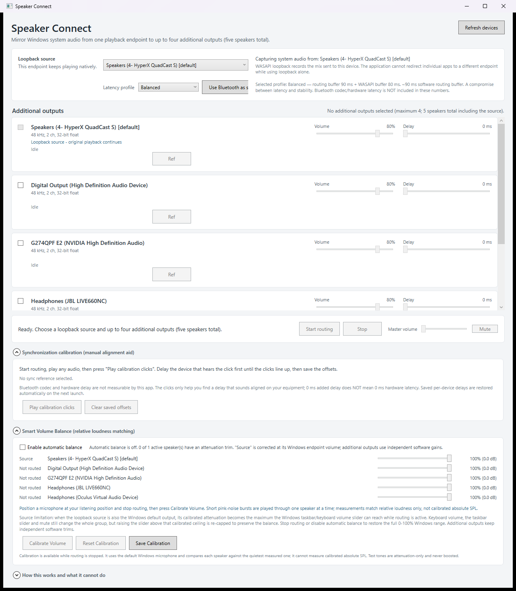
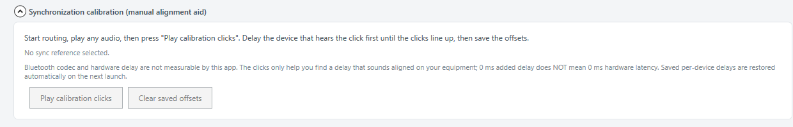
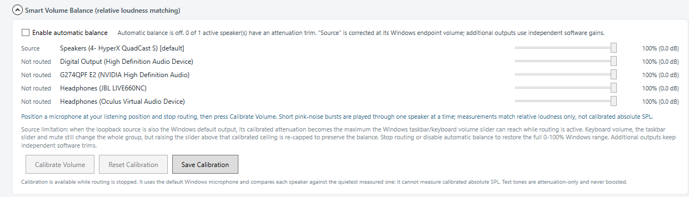

# Speaker Connect

Play Windows audio through **up to 5 wired, Bluetooth, or USB speakers simultaneously** — with synchronization aids, Windows master-volume integration, and smart volume balancing.

Speaker Connect captures the WASAPI loopback mix of one selected playback endpoint (the *source*) and renders synchronized copies to up to four additional endpoints. The original source keeps playing normally through Windows, so you get one stream heard on every speaker in the room.



*Main window: header with routing controls, loopback source card, additional-outputs device list, master volume, synchronization calibration, Smart Volume Balance, and a limitations reference.*

### Device selection and outputs


*The "Additional outputs" card lists every render endpoint with a checkbox, per-device volume trim, delay control, and reference-speaker button. Up to four destinations can be checked (five audible endpoints including the source).*

### Master volume and transport


*Start/Stop routing buttons sit above the group master-volume slider and mute button. Windows keyboard keys and the taskbar slider drive the same logical volume.*

### Synchronization calibration



*The calibration expander plays a short burst through each selected destination, one at a time, so you can align them by ear with the per-device delay controls. Saved offsets persist between sessions.*

### Smart Volume Balance



*The balance expander shows the enable checkbox, a per-speaker attenuation slider for every endpoint (source and outputs), live status, the source-endpoint limitation note, and the Calibrate / Reset / Save buttons.*

## Features

- **Up to 5 audible endpoints** — one loopback source plus up to four additional outputs (wired, Bluetooth, USB, or virtual devices).
- **Windows master-volume integration** — keyboard volume keys, the taskbar slider, and mute/unmute drive the whole group through one logical master volume, with smooth gain ramps (no pops) and per-device trims preserved.
- **Smart Volume Balance** — microphone-based relative loudness matching. Short pink-noise bursts are played through one speaker at a time; attenuation-only corrections are computed, applied live, and persisted per endpoint so speakers reconnect with their balance intact.
- **Synchronization aids** — per-device delay (0–2000 ms), a manual calibration-click workflow to align destinations by ear, and a reference-speaker mode.
- **Latency profiles** — Low latency / Balanced / Stable presets controlling the software jitter buffer and WASAPI render buffer, plus automatic stability fallback that rebuilds a starving destination with a more robust profile.
- **Live diagnostics** — per-destination buffer depth, underruns, dropped frames, drift corrections, and estimated *software* routing latency.
- **Graceful device handling** — endpoint add/remove notifications, per-device failure isolation, and a single-instance guard against feedback loops.

## Requirements

- Windows 10 or Windows 11 (64-bit)
- .NET 8 Desktop Runtime **only if you build from source** — the packaged release is self-contained and needs nothing extra
- At least two active playback endpoints for routing (one source + one destination)
- A microphone for Smart Volume Balance calibration (any Windows default recording device)

## Install and run

1. Download `SpeakerConnect-win-x64.zip` from the [latest release](../../releases/latest).
2. Extract the ZIP to a folder of your choice (no installer required).
3. Run `SpeakerConnect.exe`.

The app is **not digitally signed**. Windows SmartScreen may show a warning for unsigned apps — click **More info → Run anyway** if you trust the source.

## Connecting speakers

- **Wired / USB speakers and headphones** appear automatically as render endpoints.
- **Bluetooth speakers**: pair them in Windows Settings → Bluetooth & devices first. They then appear as normal playback endpoints. Note that Bluetooth adds codec/transport latency that this app cannot measure or fully compensate — see [Known limitations](#known-limitations).
- **Virtual audio devices** (e.g., VR headsets, virtual cables) also appear and can be used as source or destination.

## Selecting devices

1. Pick a **Loopback source** — the endpoint whose audio you want to mirror. Windows keeps playing to it normally.
2. Check up to **four additional outputs**. The source plus checked outputs must not exceed five audible endpoints total.
3. The source cannot be its own destination (that would create a feedback loop).

## Volume control

- The **master volume slider** and Windows keyboard/taskbar volume control the whole group as one logical level. Changes ramp smoothly to every destination.
- Each device row has its own **volume trim** (software gain, independent of the Windows endpoint volume).
- Mute/unmute applies group-wide.

## Synchronization and calibration

Loopback copies always lag the original source by the capture/render buffer latency — exact alignment with the source is impossible, but the copies can be aligned with **each other**:

1. Start routing and play audio.
2. Open **Synchronization calibration** and click **Play calibration clicks** — a short burst plays through each selected destination, one at a time.
3. Delay the device that sounds *first* in small steps (10–50 ms) until the bursts line up.
4. Save the offsets — they persist in `%LOCALAPPDATA%\SpeakerConnect\sync-offsets.json` and restore on the next launch.

A **reference speaker** mode lets you pick one destination as the alignment target. Bluetooth destinations may need larger manual delays and can still drift because codec latency is variable and unmeasurable.

## Smart Volume Balance

Makes all speakers sound approximately equally loud:

1. **Stop routing** (calibration requires it).
2. Open **Smart Volume Balance**, check **Enable automatic balance**, position a microphone at your listening position, and click **Calibrate Volume**.
3. The app plays ~1.5 s of band-limited pink noise through each speaker, one at a time, and measures each level. Noisy measurements are rejected.
4. Corrections are **attenuation-only** — the quietest speaker sets the target and louder speakers are turned down, never boosted, so nothing clips.
5. Results apply immediately, save by persistent endpoint ID, and restore after restart/reconnect. Per-speaker sliders allow manual trims; **Save Calibration** persists them, **Reset Calibration** clears all corrections.

**How it works under the hood:** destination corrections are software gains in the audio pipeline. The *source* speaker is special — loopback capture happens before Windows endpoint volume, so its correction is applied by lowering its endpoint volume while routing is active. If the source is also the Windows default endpoint, that attenuation becomes the maximum reachable taskbar/keyboard slider position; the app re-caps the endpoint above it to preserve balance. Stop routing or disable balance to restore the full Windows range.

> Calibration measures **relative** loudness only — the microphone is not calibrated for absolute SPL, and results depend on mic placement and room noise. Re-run after moving speakers.

## Build from source

```powershell
git clone https://github.com/jock1111/SpeakerConnect.git
cd SpeakerConnect
dotnet build SpeakerConnect.slnx -c Release
```

Run:

```powershell
.\SpeakerConnect\bin\Release\net8.0-windows\SpeakerConnect.exe
```

### Self-contained publish

```powershell
dotnet publish SpeakerConnect/SpeakerConnect.csproj -c Release -r win-x64 --self-contained true -o publish/win-x64
```

## Diagnostics

The solution includes `SpeakerConnect.Diagnostics`, a console test harness.

Hardware-independent logic tests (safe anywhere):

```powershell
dotnet run --project SpeakerConnect.Diagnostics -c Release
```

Hardware tests (muted init, buffer profiles, real endpoint volume notifications, source balance mapping):

```powershell
dotnet run --project SpeakerConnect.Diagnostics -c Release -- --hardware
```

End-to-end loopback signal test (plays a quiet 440 Hz tone through real endpoints):

```powershell
dotnet run --project SpeakerConnect.Diagnostics -c Release -- --signal
```

> `--hardware` and `--signal` change the system volume temporarily (restored afterward) and emit test tones. They are not run in CI.

## Project structure

```text
SpeakerConnect/                  WPF application
  Audio/                         Capture, routing engine, volume manager, calibration
  Infrastructure/                MVVM helpers, persistence stores
  Models/                        Device and routing models
  ViewModels/                    MainWindow view models
SpeakerConnect.Diagnostics/      Console diagnostics harness
SpeakerConnect.slnx              Solution file
```

Audio chain per destination:

```text
WASAPI loopback capture (source mix)
  → shared ring buffer → per-output jitter buffer (delay + drift pacing)
  → resample → software gain (trim × balance × master) → channel map
  → PCM/float encode → WasapiOut → destination endpoint
```

## Known limitations

- **Loopback is a tap, not a router.** Windows apps still choose their own output endpoint; this app mirrors the *mix* playing on the source endpoint. It cannot route individual applications independently — that requires a virtual audio driver (see the "virtual endpoint architecture" note in the docs/README history).
- **The source always plays** and cannot be delayed or muted by this app. Copies lag it by at least the buffer latency.
- **Bluetooth latency is unknown and variable.** Codec/transport delay is not measurable through WASAPI; use the delay controls and calibration clicks, and expect imperfect sync on Bluetooth destinations.
- **No sample-accurate sync.** Drift correction inserts/sheds small amounts of audio; it is a jitter-buffer policy, not a hardware-clock lock.
- **Smart Volume Balance is relative, not absolute SPL**, and the source-endpoint volume cap described above applies when the source is the Windows default device.
- **Shared-mode WASAPI only.** Exclusive-mode endpoints, protected content, and some driver formats may fail; failures are reported per device.
- **Not digitally signed** — expect a SmartScreen prompt on first run.

## Troubleshooting

- **"Select at least one additional output"** — check at least one destination besides the source.
- **A destination shows errors or drops** — try a more robust latency profile (Stable), increase its delay, or check the device isn't being used exclusively by another app.
- **No audio on a destination** — confirm Windows isn't muting that endpoint and that its format is PCM/float (the app falls back automatically for most formats).
- **Volume keys don't change routed audio** — the app mirrors the *default* render endpoint's volume; if your source isn't the Windows default, change volume in-app or set the source as default.
- **Balance calibration fails** — check the default recording device is your intended microphone, stop other audio, and reduce background noise.
- **Second instance won't start** — Speaker Connect uses a single-instance guard to prevent feedback loops.

## License

[MIT](LICENSE) © Kevin Pushka

Third-party dependency: [NAudio](https://github.com/naudio/NAudio) (MIT License) — .NET audio library used for WASAPI, loopback capture, and device enumeration.
