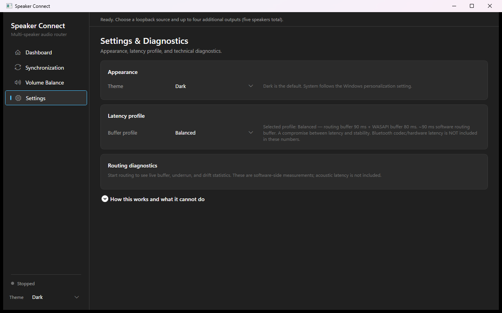

# Speaker Connect

Play Windows audio through **up to 5 wired, Bluetooth, or USB speakers simultaneously** — with synchronization aids, Windows master-volume integration, and smart volume balancing.

Speaker Connect captures the WASAPI loopback mix of one selected playback endpoint (the *source*) and renders synchronized copies to up to four additional endpoints. The original source keeps playing normally through Windows, so you get one stream heard on every speaker in the room.

Speaker Connect uses a sidebar navigation layout with four pages: **Dashboard**, **Synchronization**, **Volume Balance**, and **Settings & Diagnostics**. Dark and light themes are supported (Settings → Theme, or the sidebar picker).


*Dashboard: routing status and Start/Stop control, master volume and mute, the loopback source picker, and responsive speaker cards with selection, badges, per-speaker volume, delay, and reference controls.*

### Speaker cards


*Each speaker card shows the endpoint name, connection hints (Default, Bluetooth-style name match), role badges (Source / Output / Reference), a route checkbox, volume slider, delay slider, and a Ref button. Up to four destinations can be checked (five audible endpoints including the source).*

### Master volume and transport


*The Dashboard hero card shows routing state with a large Start/Stop button; the master-volume card holds the group slider and mute pill. Windows keyboard keys and the taskbar slider drive the same logical volume.*

### Synchronization


*The Synchronization page offers Auto Sync (microphone-assisted chirp measurement), a live Manual Sync burst test, a reference-speaker selector, per-speaker delay and measured-offset status (relative to the acoustic anchor — negative means earlier), Reset Sync, and Save Calibration.*

### Smart Volume Balance


*The Volume Balance page shows the enable checkbox, Calibrate / Reset / Save buttons, live status, the source-endpoint limitation note, and a per-speaker attenuation slider for every endpoint (source and outputs).*

### Settings and diagnostics



*The Settings page holds the theme picker, latency buffer profile, live routing diagnostics while running, and a collapsible explanation of what the application can and cannot do.*

## Features

- **Up to 5 audible endpoints** — one loopback source plus up to four additional outputs (wired, Bluetooth, USB, or virtual devices).
- **Windows master-volume integration** — keyboard volume keys, the taskbar slider, and mute/unmute drive the whole group through one logical master volume, with smooth gain ramps (no pops) and per-device trims preserved.
- **Smart Volume Balance** — microphone-based relative loudness matching. Short pink-noise bursts are played through one speaker at a time; attenuation-only corrections are computed, applied live, and persisted per endpoint so speakers reconnect with their balance intact.
- **Synchronization** — microphone-assisted **Auto Sync** (linear chirp + normalized cross-correlation on the live routing path), a live **Manual Sync** burst train for aligning by ear, per-device delay (0–2000 ms UI), measured per-speaker offsets relative to the acoustic anchor, honest confidence/failure reporting, and Reset / Save Calibration.
- **Automatic settings restore** — per-device delay, individual volume, output-group membership, loopback source, sync reference, and Smart Volume Balance calibration are saved automatically by persistent endpoint id and restored after a restart or reconnect.
- **Latency profiles** — Low latency / Balanced / Stable presets controlling the software jitter buffer and WASAPI render buffer, plus automatic stability fallback that rebuilds a starving destination with a more robust profile.
- **Live diagnostics** — per-destination buffer depth, underruns, dropped frames, drift corrections, and estimated *software* routing latency.
- **Graceful device handling** — endpoint add/remove notifications, per-device failure isolation, and a single-instance guard against feedback loops.

## Requirements

- Windows 10 or Windows 11 (64-bit)
- .NET 8 Desktop Runtime **only if you build from source** — the packaged release is self-contained and needs nothing extra
- At least two active playback endpoints for routing (one source + one destination)
- A microphone for Smart Volume Balance calibration (any Windows default recording device)

## Install and run

1. Download the `SpeakerConnect-*-win-x64.zip` asset from the [latest release](../../releases/latest).
2. Extract the ZIP to a folder of your choice (no installer required).
3. Run `SpeakerConnect.exe`.

The app is **not digitally signed**. Windows SmartScreen may show a warning for unsigned apps — click **More info → Run anyway** if you trust the source.

## Connecting speakers

- **Wired / USB speakers and headphones** appear automatically as render endpoints.
- **Bluetooth speakers**: pair them in Windows Settings → Bluetooth & devices first. They then appear as normal playback endpoints. Note that Bluetooth adds codec/transport latency that this app cannot measure or fully compensate — see [Known limitations](#known-limitations).
- **Virtual audio devices** (e.g., VR headsets, virtual cables) also appear and can be used as source or destination.

## Selecting devices

1. Pick a **Loopback source** — the endpoint whose audio you want to mirror. Windows keeps playing to it normally.
2. Check up to **four additional outputs**. The source plus checked outputs must not exceed five audible endpoints total.
3. The source cannot be its own destination (that would create a feedback loop).

## Volume control

- The **master volume slider** and Windows keyboard/taskbar volume control the whole group as one logical level. Changes ramp smoothly to every destination.
- Each device row has its own **volume trim** (software gain, independent of the Windows endpoint volume).
- Mute/unmute applies group-wide.

## Synchronization and calibration

Loopback copies always lag the original source by the capture/render buffer latency — exact alignment with the source is impossible, but the copies can be aligned with **each other**. Routing must be running for both sync tools.

### Auto Sync

1. Start routing and keep ambient noise low. Position a microphone (the Windows default recording device) where it can hear all speakers.
2. Open **Synchronization**, optionally pick a **reference speaker**, and click **Auto Sync**.
3. For each destination the app injects a short linear chirp into the shared audio stream at a known content time and unmutes only that speaker (via a ramped test gain), so the microphone records one path at a time. The loopback source is then measured by playing the chirp natively through its endpoint and detecting it in the capture stream.
4. Arrival times are compared against the known content times; the arbitrary microphone/capture origin cancels, so only **relative** differences between speakers are used. Delays are computed to align every destination to the latest reliable measured path (the *acoustic anchor*, shown as `0 ms reference`; negative offsets mean a speaker sounded earlier).
5. A successful plan is applied and persisted immediately, so delays and measurement metadata survive reconnect and restart. **Save Calibration** additionally stores the current delays together with the measured offset, confidence, method, and timestamp.

Measured offsets are **relative to the anchor, not absolute hardware latency** — the correlation offset shares an arbitrary recording origin, so the app never presents it as a physical latency figure. If any destination cannot be measured reliably (low confidence, drift between trials, or no chirp found), the whole plan is rejected and no delays change; the manual test remains available. An unreliable source is reported separately and does not block aligning the destinations with each other.

### Manual Sync

**Manual Sync** plays a train of short bursts natively through the loopback source while routing continues, so every destination receives the same signal through the real delayed path. Listen for flam/echo and adjust the per-device delay sliders by ear; the sliders stay editable during the test. This is a listening aid, not a measurement.

### Source limitation

The loopback source is rendered directly by Windows and **cannot be delayed by the app**. If Auto Sync finds the source is earlier than the acoustic anchor, it reports the deficit and explains that the fix is to choose a later speaker as the source (or use a virtual-endpoint architecture) — it never suggests delaying an already-late speaker as a fix.

### Reset

**Reset Sync** clears all configured delays and measured timing metadata but keeps the manual reference selection.

Bluetooth destinations may need larger delays and can still drift because codec latency is variable and only partially measurable; Auto Sync widens its search windows for endpoint/WASAPI latency but cannot guarantee a stable result on every Bluetooth link.

## Smart Volume Balance

Makes all speakers sound approximately equally loud:

1. **Stop routing** (calibration requires it).
2. Open **Smart Volume Balance**, check **Enable automatic balance**, position a microphone at your listening position, and click **Calibrate Volume**.
3. The app plays ~1.5 s of band-limited pink noise through each speaker, one at a time, and measures each level. Noisy measurements are rejected.
4. Corrections are **attenuation-only** — the quietest speaker sets the target and louder speakers are turned down, never boosted, so nothing clips.
5. Results apply immediately, save by persistent endpoint ID, and restore after restart/reconnect. Per-speaker sliders allow manual trims; **Save Calibration** saves them alongside existing endpoint gains (including temporarily disconnected speakers), and **Reset Calibration** clears all corrections.

**How it works under the hood:** destination corrections are software gains in the audio pipeline. The *source* speaker is special — loopback capture happens before Windows endpoint volume, so its correction is applied by lowering its endpoint volume while routing is active. If the source is also the Windows default endpoint, that attenuation becomes the maximum reachable taskbar/keyboard slider position; the app re-caps the endpoint above it to preserve balance. Stop routing or disable balance to restore the full Windows range.

> Calibration measures **relative** loudness only — the microphone is not calibrated for absolute SPL, and results depend on mic placement and room noise. Re-run after moving speakers.

## Saved settings

Speaker Connect saves settings automatically; there is no separate "Save settings" button. Files live under `%LOCALAPPDATA%\SpeakerConnect\` and are keyed by the persistent Windows MMDevice endpoint id, so the same physical speaker or headset recovers its values after a restart or a temporary disconnect/reconnect.

`device-settings.json` stores:

- **Per endpoint id** — manual synchronization delay (clamped to 0–5000 ms; the UI exposes 0–2000 ms), individual speaker volume percentage (clamped to 0–100%), whether that endpoint is in the selected output group, and optional Auto Sync measurement metadata (relative offset in ms, confidence percent, method string, and measurement timestamp).
- **Globally** — the selected loopback source endpoint id and the selected synchronization reference endpoint id.

Updates are per field and per device. Changing one speaker never rewrites another speaker's entry, and a currently disconnected endpoint keeps its saved entry. If a saved source or reference is absent, the application falls back to a usable connected device without deleting the saved id; the saved choice returns when that endpoint reconnects. The source, reference, and group are restored on the next launch.

`volume-balance.json` stores the Smart Volume Balance enabled preference and the attenuation-only gain for each endpoint id. **Save Calibration** merges manual trims with the already-saved gains, so a temporarily disconnected speaker does not lose its calibration. **Reset Calibration** clears the gains but keeps the enabled preference.

Writes are coalesced for 300 ms and flushed when routing stops and when the window closes. Each file is written to a temporary file and swapped into place, so an interrupted write leaves either the previous complete file or the new complete file, never a half-written document. If a settings file is corrupt, it is renamed to `<name>.corrupt-<UTC timestamp>` and the application starts with safe defaults.

The files do **not** store the routing on/off state, the selected buffer profile, or master volume/mute. Master volume and mute continue to follow the Windows endpoint while the application runs.

To check persistence manually, change a speaker's volume and delay, toggle its output checkbox, choose a source and sync reference, then close and reopen the application. The same values should return. Disconnect and reconnect a destination; its saved values should return while the other devices' saved values remain unchanged.

## Build from source

```powershell
git clone https://github.com/jock1111/SpeakerConnect.git
cd SpeakerConnect
dotnet build SpeakerConnect.slnx -c Release
```

Run:

```powershell
.\SpeakerConnect\bin\Release\net8.0-windows\SpeakerConnect.exe
```

### Self-contained publish

```powershell
dotnet publish SpeakerConnect/SpeakerConnect.csproj -c Release -r win-x64 --self-contained true -o publish/win-x64
```

## Diagnostics

The solution includes `SpeakerConnect.Diagnostics`, a console test harness.

Hardware-independent logic tests (safe anywhere):

```powershell
dotnet run --project SpeakerConnect.Diagnostics -c Release
```

Hardware tests (muted init, buffer profiles, real endpoint volume notifications, source balance mapping):

```powershell
dotnet run --project SpeakerConnect.Diagnostics -c Release -- --hardware
```

End-to-end loopback signal test (plays a quiet 1234 Hz diagnostic tone through real endpoints; the measurement is narrowband so background system audio does not invalidate the gain ratios):

```powershell
dotnet run --project SpeakerConnect.Diagnostics -c Release -- --signal
```

> `--hardware` and `--signal` change the system volume temporarily (restored afterward) and emit test tones. They are not run in CI.

The harness also covers per-endpoint settings persistence: restart/reconnect recovery, preservation of a disconnected endpoint, clamping, atomic writes, corrupt-file backup, one-time legacy `sync-offsets.json` migration, and a fake-enumerator test that drives the real `MainViewModel` through save → restart → disconnect → reconnect. These tests use temporary files and do not touch real endpoints or saved user settings.

Current verification on the development machine:

- `dotnet build SpeakerConnect.slnx -c Release` — **0 warnings, 0 errors**.
- Hardware-independent diagnostics — **25/25 pass** (also runs in CI).
- Muted hardware diagnostics — **29/29 pass** (25 logic + 4 hardware).
- End-to-end loopback signal diagnostics — **31/31 pass** (25 logic + 4 hardware + 2 signal). Master-volume scaling measured 0.500/0.541; a 0.25 balance gain attenuated only its own destination (ratio 0.250) while the other stayed at unity (1.000).

The signal test unmutes the endpoints it needs and restores their volume/mute afterward. Auto Sync's microphone-assisted measurement was exercised live on the development machine: with no working microphone signal the run correctly **failed closed** (no chirp identified → no delays changed) instead of inventing measurements. A successful acoustic Auto Sync measurement, real-room alignment, and long Bluetooth sessions were **not** verified; these require a listening environment, a working microphone, and physical speakers.

## Project structure

```text
SpeakerConnect/                  WPF application
  Audio/                         Capture, routing engine, volume manager, calibration
  Infrastructure/                MVVM helpers, atomic stores, theme manager
  Models/                        Device and routing models
  Themes/                        Dark/Light brush dictionaries + shared control styles
  Views/                         Dashboard, Synchronization, Balance, Settings pages
  ViewModels/                    MainWindow view models and converters
SpeakerConnect.Diagnostics/      Console diagnostics harness
SpeakerConnect.slnx              Solution file
```

Audio chain per destination:

```text
WASAPI loopback capture (source mix)
  → shared ring buffer → per-output jitter buffer (delay + drift pacing)
  → resample → software gain (trim × balance × master) → channel map
  → PCM/float encode → WasapiOut → destination endpoint
```

## Known limitations

- **Loopback is a tap, not a router.** Windows apps still choose their own output endpoint; this app mirrors the *mix* playing on the source endpoint. It cannot route individual applications independently — that requires a virtual audio driver (see the "virtual endpoint architecture" note in the docs/README history).
- **The source always plays** and cannot be delayed or muted by this app. Copies lag it by at least the buffer latency.
- **Bluetooth latency is unknown and variable.** Codec/transport delay is not fully measurable through WASAPI; Auto Sync widens its correlation windows for endpoint latency but cannot guarantee a stable result on every Bluetooth link, and drift remains possible.
- **Auto Sync measures relative timing only.** Reported offsets are differences between speakers against the acoustic anchor; absolute hardware latency is unknown and never displayed.
- **Auto Sync needs a working microphone.** If the default recording device is muted, too far away, or too noisy, the run fails closed and manual sync remains available.
- **No sample-accurate sync.** Drift correction inserts/sheds small amounts of audio; it is a jitter-buffer policy, not a hardware-clock lock.
- **Smart Volume Balance is relative, not absolute SPL**, and the source-endpoint volume cap described above applies when the source is the Windows default device.
- **Shared-mode WASAPI only.** Exclusive-mode endpoints, protected content, and some driver formats may fail; failures are reported per device.
- **Not digitally signed** — expect a SmartScreen prompt on first run.

## Troubleshooting

- **"Select at least one additional output"** — check at least one destination besides the source.
- **A destination shows errors or drops** — try a more robust latency profile (Stable), increase its delay, or check the device isn't being used exclusively by another app.
- **No audio on a destination** — confirm Windows isn't muting that endpoint and that its format is PCM/float (the app falls back automatically for most formats).
- **Volume keys don't change routed audio** — the app mirrors the *default* render endpoint's volume; if your source isn't the Windows default, change volume in-app or set the source as default.
- **Balance calibration fails** — check the default recording device is your intended microphone, stop other audio, and reduce background noise.
- **Auto Sync reports "could not be measured reliably"** — confirm the default recording device is a real microphone (not muted), move it closer to the speakers, reduce background noise, and retry; use Manual Sync to align by ear instead.
- **Auto Sync says the source is earlier than the anchor** — the source endpoint cannot be delayed by the app; choose a later speaker as the loopback source or align the destinations to each other.
- **Second instance won't start** — Speaker Connect uses a single-instance guard to prevent feedback loops.
- **Settings didn't return after restart** — confirm `%LOCALAPPDATA%\SpeakerConnect\device-settings.json` exists and is writable. A corrupt file is renamed with a `.corrupt-<timestamp>` suffix and the app starts with safe defaults.

## License

[MIT](LICENSE) © Kevin Pushka

Third-party dependency: [NAudio](https://github.com/naudio/NAudio) (MIT License) — .NET audio library used for WASAPI, loopback capture, and device enumeration.
